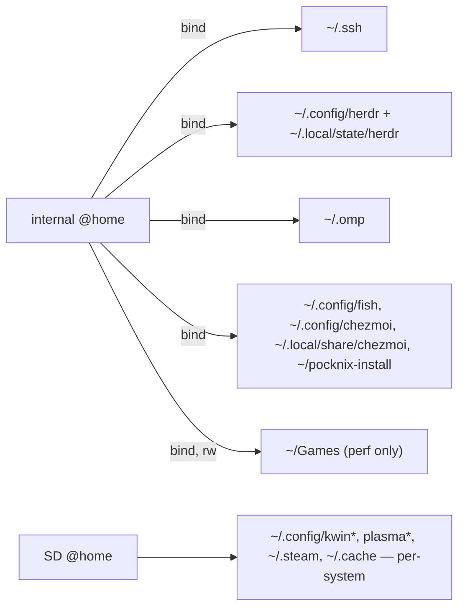

# Thor display + brightness test plan

State as of 2026-11-04, `thor` branch (chezmoi). Round 1 (this doc, right now) is **display and
brightness only**, installed on the internal system. Round 2 (sleep, GPU, input, lid) is
deferred and stays on the SD bed — its sections are at the bottom, unchanged.

| Branch (pocknix-os) | Tip | Contents |
|---|---|---|
| `thor/brightness-gamma` | `17a0c1a` | 1097 (per-panel gamma in `panel-ddic-ch13726a`) + `pocknix,brightness-*` DT props. `KERNEL_PKGREL=14` |
| `thor/armada-kernel-import` | `34b43d7` | 1090–1096 + lid/dither DT — **round 2**, needs the SD |

Artifacts for round 1: `~/pocknix-brightness/{0001-*.patch, brightness-gamma.bundle}`.

```sh
git fetch /tmp/pocknix2 thor/brightness-gamma     # while that clone lives
# else: git am ~/pocknix-brightness/0001-*.patch
```

Verified before handing over (do not redo): 1097 applies with `--fuzz=0` on main's 7.2.10 stack,
`panel-ddic-ch13726a.o` builds, `scripts/check.sh` passes, and the decoded Thor dtb carries only
`pocknix,brightness-gamma-milli = <0xa8c>` + `pocknix,brightness-min = <0x01>` (no armada/sleep
content — that was checked deliberately).

## What 1097 does, and what the readback will *not* show

`ch13726a_bl_update_status()` maps the requested level through `x^gamma` (integer only) before
writing DCS 0x51. Gamma and floor come from the bottom panel node:

```dts
pocknix,brightness-gamma-milli = <2700>;
pocknix,brightness-min = <1>;
```

**`cat /sys/class/backlight/ae94000.dsi.0/brightness` still returns the value that was written.**
The backlight class stores what userspace asked for; only the wire value is curved. That is
deliberate — it is what keeps kwin and Steam's readback honest — but it means the curve cannot be
observed through sysfs. The patch logs the mapped value at debug level for exactly that reason:

```sh
# 'echo … | tee <control>' echoes its own input, which says nothing about whether the match
# landed. Enable and then READ the callsite back — it must end in '=p'.
sudo sh -c 'echo "file *ch13726a* +p" > /sys/kernel/debug/dynamic_debug/control
             grep ch13726a /sys/kernel/debug/dynamic_debug/control'
sudo dmesg -w | grep 'level '        # "level 79 -> 11"
...
echo 'file panel-ddic-ch13726a.c -p' | sudo tee /sys/kernel/debug/dynamic_debug/control   # off
```

# Phase 0 — baseline, before flashing (5 min)

Capture the *pairs* at several levels, not just the current one, so the curve can be checked
against the table below afterwards.

```sh
uname -v                                     # record the build timestamp (uname -r stays 7.2.10; #N is always 1)
md5sum /flash/KERNEL | cut -d' ' -f1
# Copy the LIVE image, not KERNEL.bak: .bak is whatever the last deploy rotated out and is not
# necessarily the image you are running (2026-11-04: .bak was a different 20.6 MB build while
# KERNEL was md5 3b615dfb... — the one actually booted). The running image is the only one with
# proof behind it.
sudo cp -f /flash/KERNEL /flash/KERNEL.good
printf '%s  KERNEL.good\n' "$(sudo md5sum /flash/KERNEL.good | cut -d' ' -f1)" | sudo tee /flash/KERNEL.good.md5
cmp -s /flash/KERNEL /flash/KERNEL.good && echo 'known-good copy matches the running image'

for p in 500 1000 2000 2500 3100 5000 7500 10000; do
  busctl --user call org.kde.Solid.PowerManagement \
    /org/kde/Solid/PowerManagement/Actions/BrightnessControl \
    org.kde.Solid.PowerManagement.Actions.BrightnessControl setBrightness i "$p"
  sleep 1     # kwin animates: 3-7 writes over ~420 ms, so read only after it settles
  printf '%5s top %s bottom %s\n' "$p" \
    "$(cat /sys/class/backlight/ae96000.dsi.0/brightness)" \
    "$(cat /sys/class/backlight/ae94000.dsi.0/brightness)"
done | tee ~/brightness-before.txt
```

Expected before: both columns move together as the *same percentage* while the bottom panel is
visibly brighter. Current standing state (25 %): top `860/3413`, bottom `64/255`.

Optional, only if you will do round 2 soon: the 30-minute drain baseline
(`sudo rtcwake -m mem -s 1800`) is cheaper to take here than to reconstruct later.

# Phase 1 — build, install, prove (internal, ~20 min + build)

```sh
git checkout thor/brightness-gamma          # in pocknix-os
DEVICE=sm8550 make kernel                   # incremental if you built before
sudo DEVICE=sm8550 make packages PKG=linux-pocknix-sm8550
sudo pacman -U build/localrepo/sm8550/linux-pocknix-sm8550-7.2.10-14-aarch64.pkg.tar.*
sudo reboot
```

`90-linux-pocknix.hook` → `pocknix-boot-deploy` → `pocknix-build-bootimg` rebuilds
`/flash/KERNEL` from `/boot/Image` + `/boot/dtbs/*.dtb` + `/usr/lib/pocknix/kernel-cmdline`, and
rotates the old image to `KERNEL.bak`. Since every rebuild rotates it, the `.good` copy from
phase 0 is the one you fall back to.

Prove what booted (both halves must be live). `#N` does **not** increment — each build starts in a
fresh tree, so it is always `#1`; compare the **build timestamp** and the DT properties instead
(baseline was `#1 SMP PREEMPT Thu Oct 29 16:33:20 CET 2026`):

```sh
uname -v                                            # must show the new build's date/time
# NOTE: 'find' on this image is 0.8.0, not GNU find — it does not descend /proc, so
# `find /proc/device-tree -name 'pocknix,*'` returns nothing even when the properties are there.
ls /proc/device-tree/soc@0/display-subsystem@ae00000/dsi@ae94000/panel@0/ | grep pocknix
od -An -tx4 /proc/device-tree/soc@0/display-subsystem@ae00000/dsi@ae94000/panel@0/pocknix,brightness-gamma-milli
```

# Phase 2 — acceptance

## 2.1 Mapping (objective) — the curve is doing what it claims

Enable the debug line (see above), then drive levels and compare against this table. `top` is the
raw top node; `bottom request` is what Plasma writes; `bottom mapped` is what the *panel* receives
and what the log must print.

| % | top /3413 | bottom request /255 | bottom mapped (γ 2.7) |
|---:|---:|---:|---:|
| 5 | 171 | 13 | 1 |
| 10 | 341 | 26 | 1 |
| 20 | 683 | 51 | 3 |
| 25 | 853 | 64 | 6 |
| 31 | 1058 | 79 | 11 |
| 40 | 1365 | 102 | 21 |
| 50 | 1706 | 128 | 40 |
| 62 | 2116 | 158 | 70 |
| 75 | 2560 | 191 | 117 |
| 90 | 3072 | 230 | 193 |
| 100 | 3413 | 255 | 255 |

`PowerDevil 3100` must log `level 79 -> 11`. Tolerance ±1. Disable the debug line when done —
kwin's animation produces 3–7 writes per change.

## 2.2 The actual defect — do the panels match?

Put the same content on both screens (a white/grey window on each, or a photo), sweep 10 → 100 %,
and compare. Pass = neither screen is "the bright one". This is the only test that settles the
fix; 2.1 only proves the arithmetic.

If it is still off, that is a tuning result, not a failure — go to phase 3.

## 2.3 No flash

Drag the slider slowly, then jump 10 → 100 % in one move, watching the **bottom** panel. Pass = no
step, no strobe, no late catch-up. (This was the whole reason the curve lives in the driver.)

## 2.4 Floor and off

```sh
printf 1 | sudo tee /sys/class/backlight/ae94000.dsi.0/brightness   # dim, not black
printf 0 | sudo tee /sys/class/backlight/ae94000.dsi.0/brightness   # off
```
Then Plasma at its lowest: the powerdevil floor (5 %) now maps the bottom panel to 1/255. Look at
it — if that reads as "off" rather than "dim", raise `pocknix,brightness-min` to 2 or 3.

## 2.5 Consumers unchanged

| Path | Check |
|---|---|
| Plasma slider / shade | moves both panels, applet still reads 0–100 % |
| quicksettings tile | cycles 100/75/50/25/10, and `journalctl --user -b \| grep -c 'Getting brightness failed'` stays 0 (the ordering drop-in is what keeps the slider) |
| Steam Game Mode slider | moves the **top** panel (via `steamos-priv-write`), bottom stays dark; no `steamos-priv-write: cannot set` in the journal |
| suspend/resume | brightness survives; a resume does not jump the bottom panel |

## 2.6 Regressions to watch

- `dmesg` / `journalctl -k`: no `panel-ch13726a` errors, no DSI timeouts during animation.
- `dmesg | grep -c 'dpu error'` no higher than the phase 0 count (this patch touches no DPU code).
- Steam Mode still launches; no brightness loop (a log of `level X -> Y` repeating forever with no
  input would mean a writer feedback loop — should not exist, nothing reads the curved value).

# Phase 3 — iterate on the gamma (dtb-only loop)

One number, ~2 min per try:

```sh
# edit pocknix,brightness-gamma-milli in kernel/sm8550/dts/qcom/qcs8550-ayn-thor.dts
DEVICE=sm8550 make kernel
sudo cp build/kernel/sm8550/out/dtbs/qcs8550-ayn-thor.dtb /boot/dtbs/
sudo pocknix-build-bootimg && sudo reboot
```

No pacman, no snapshot, no package build. Record the value you settle on — that is the number for
this panel/unit, and the doc's open question 1 gets its first data point.

Start points if 2.7 is not it: too bright at low levels → raise (2.9, 3.1); too dim → lower
(2.4, 2.2). Check the same three levels each time (10 %, 31 %, 62 %) so the comparison is honest.

# Phase 4 — record, and hand back

- Note the settled gamma + floor and the `uname -v` of the tested build in this doc.
- Keep `~/brightness-before.txt` next to the "after" run for the record.
- If the gamma changed, that is the value to carry into `thor/armada-kernel-import` (the DT hunk is
  identical there) before the sleep round.
- Re-enable nothing: the debug line is opt-in per boot, so a reboot returns the driver to silent.

---

# Round 1 results (2026-11-05)

Build `linux-pocknix-sm8550 7.2.10-14`, `uname -v` → `#1 SMP PREEMPT Wed Nov 4 18:38:08 CET 2026`
(baseline was `Thu Oct 29 16:33:20`), `/flash/KERNEL` md5 `4ca2af60…` matches `KERNEL.md5`.

| Check | Result |
|---|---|
| DT live on the bottom panel | `dsi@ae94000/panel@0`: `pocknix,brightness-gamma-milli` = 0x00000A8C (2700), `brightness-min` = 0x1 |
| curve applied | `level 79 -> 11`, plus 18 samples across one 5→100 % sweep (12…255), all within ±1 of the table |
| floor | `1 -> 1`, `2 -> 1`, `3 -> 1`; `0 -> 0` (off preserved) |
| panels match | **pass** at 31 %, judged on the Plasma slider (PowerDevil driving both) |
| no flash | **pass** — slow drag and a 10→100 % jump |
| Steam Game Mode | **pass** — slider moves the top panel, bottom stays dark |
| dmesg | 0 `dpu error`, 0 GMU timeouts, 0 `ch13726a` errors |

**Methodology trap (cost a false "too low" reading):** staging a level with a raw
`printf 79 > /sys/class/backlight/…/brightness` does not produce a valid comparison. PowerDevil/kwin
keep their own model and re-assert it on the next event, so one node snaps back while the other
stays where you wrote it. Stage levels **only** through
`busctl --user call … BrightnessControl setBrightness i <0..10000>` with a ≥1 s settle.

**Low end is coarse, and the floor is where you want it.** Measured on the Plasma slider:

```
set 0 / 250 / 500 -> top 172 (5.0%)  bottom req 12 -> mapped 1     (identical: powerdevil clamps)
set 750           -> top 257 (7.5%)  bottom req 19
set 1000          -> top 342 (10.0%) bottom req 25
```

`knownSafeMinBrightness() = max/20` (5 %) clamps slider 0–5 % onto one level, which is the level
judged correct as the minimum — so **no change**: `brightness-gamma-milli = 2700`,
`brightness-min = 1`. Settled by eye at 10 %, 31 % and 60 %.

If the minimum ever needs to be brighter it is a **powerdevil** change (`max/20` → `max/13` or
`max/10`), not a dtb one: raising the floor lifts the top panel to 257/342 while the bottom stays
pinned at 1/255 until ~16 % of the slider (its next step is 2/255), so the bottom reads slightly
brighter than the top across that band. Price of a 255-level panel under gamma 2.7.

**Not a failure:** switching to Game Mode kills kwin, so PowerDevil logs
`The Wayland connection broke` and exits, and D-Bus brightness control disappears until the next
Plasma session. Stage and judge brightness in Plasma; Game Mode goes through `steamos-priv-write`.

---

# Round 2 (deferred) — sleep, GPU, input, lid

Everything below applies to `thor/armada-kernel-import` and is why the SD bed exists.

## Why the SD card

- The SD is a separate boot chain: internal `/flash/KERNEL`, modules and rootfs stay on the
  known-good kernel. A sleep regression cannot strand the daily driver.
- Recovery is firmware-level: hold **Volume −** at power-on (ABL v1.2 here; boot-source switching
  needs ≥ 1.1.7) → `Switch boot source` → Internal. Volume keys move, power selects.
- While booted from SD, internal `/flash` is not mounted, so `pacman -U` deploys to the card only.

### Hazard: the boot cmdline is not pinned

Both installs label their root partition `POCKNIX_ROOT`, and the boot image's cmdline (baked by
`make kernel`) is `root=PARTLABEL=POCKNIX_ROOT rw`. The fstab is unambiguous (PARTUUID), the
`root=` is not. Verify on the first SD boot:

```sh
findmnt -no SOURCE,FSTYPE /     # must be the card, not /dev/sda19
```

If it lands on internal, pin the card's own deploy to its PARTUUID:

```sh
sudo sh -c 'sed -i "s|root=PARTLABEL=POCKNIX_ROOT|root=PARTUUID=706f636b-6e69-7830-726f-6f7400000002|" /usr/lib/pocknix/kernel-cmdline'
sudo pocknix-cmdline-sync
```

Do that **before** installing the test kernel: every rebuild rotates `/flash/KERNEL.bak`, and the
fallback must stay the known-good image.

## Round 2 identifiers

| | internal | SD image |
|---|---|---|
| boot FAT | `sda18` `POCKNIX`, PARTUUID `50711efc-99a3-461a-848e-b34a0567ac58` | p1, GPT name `system`, label `POCKNIX`, PARTUUID `706f636b-6e69-7830-626f-6f7400000001` |
| root btrfs | `sda19` `POCKNIX_ROOT`, PARTUUID `ca44148c-fab6-441f-8915-1043dea3aa2e` | p2, `POCKNIX_ROOT`, PARTUUID `706f636b-6e69-7830-726f-6f7400000002` |

## Round 2 setup

1. Flash a published `pocknix-sm8550` SD image — **same 0.5.0 / 20261023.1 base** as internal, so
   the only variable is the kernel. Volume − at power-on → `Switch boot source` → SD Card.
2. Verify identity, pin the cmdline (above), then `sudo pacman -U` the
   `thor/armada-kernel-import` package (`pkgrel 14`; bump one of the two branches' `pkgrel` when
   you merge so `pacman -Q` is unambiguous).
3. Your toolchain: `herdr-bin` and `oh-my-pi-bin` are locally built (Packager: Unknown, absent
   from every configured repo), so a fresh image cannot `pacman -S` them:
   ```sh
   mkdir -p ~/.local/bin && cp /usr/bin/herdr /usr/bin/omp ~/.local/bin/   # or shared from internal
   chezmoi apply -v
   sudo ~/pocknix-install/install.sh               # steamos-priv-write + services
   ```
4. SSH across boot sources: host keys are per-install, so copy internal's to the card or the
   laptop will refuse the connection (`REMOTE HOST IDENTIFICATION HAS CHANGED`):
   ```sh
   sudo cp -a /path/to/internal/etc/ssh/ssh_host_* /etc/ssh/ && sudo systemctl restart sshd
   ```
   `~/.ssh/authorized_keys` does not exist today — add the laptop's public key.
   `PermitRootLogin no` comes from `10-pocknix-no-root-login.conf`.

## Round 2 sharing map



```fstab
PARTUUID=ca44148c-fab6-441f-8915-1043dea3aa2e  /mnt/internal  btrfs  rw,noatime,compress=zstd:1,subvol=@home  0 0
/mnt/internal/deck/.ssh                          /home/deck/.ssh                 none  bind,x-systemd.requires-mounts-for=/mnt/internal  0 0
/mnt/internal/deck/.omp                          /home/deck/.omp                 none  bind,x-systemd.requires-mounts-for=/mnt/internal  0 0
/mnt/internal/deck/.config/herdr                 /home/deck/.config/herdr        none  bind,x-systemd.requires-mounts-for=/mnt/internal  0 0
/mnt/internal/deck/.local/state/herdr            /home/deck/.local/state/herdr   none  bind,x-systemd.requires-mounts-for=/mnt/internal  0 0
```

## Round 2 checklist

```sh
for i in $(seq 1 10); do sudo rtcwake -m mem -s 20; \
  printf '%s uptime=%s wifi=%s\n' $i "$(cut -d' ' -f1 /proc/uptime)" \
    "$(ping -c1 -W2 1.1.1.1 >/dev/null && echo ok || echo DOWN)"; done | tee ~/cycles.log
```

- **1094 go:** uptime rises monotonically (a hard reset restarts it), `wifi ok` every line,
  `cat /sys/kernel/debug/suspend_stats/last_failed_dev` empty; then repeat the 30-minute drain and
  compare %/h — that delta is the whole payoff, no log proves the GDSC collapse.
- **1094 no-go:** hard reset or dead wifi → restore
  `1049-arm64-dts-qcom-sm8550-mark-pcie-suspend-opp.patch` from `origin/main`, delete the `1048`
  line from `kernel/sm8550/common-skip`, bump `KERNEL_PKGREL`, rebuild.
- **1095:** suspend with music playing, resume, play again — no
  `failed to re-enable the I2S clock` in `journalctl -k`.
- **1090:** `dmesg | grep -c 'GMU firmware initialization timed out'` stays 0 across boots.
- **1096:** `evtest` on the gamepad, hammer sticks/triggers, 3 × suspend/resume; no
  `RX buffer overflow` lines.
- **1092 dither (top panel):** dark gradient in Gwenview + one dark HDR scene; A/B by rebuilding
  the dtb without `armada,dpu-8bpc-dither`.
- **Lid:** `sudo pacman -S evtest`; SW_LID 1 on close, 0 on open; suspend on close, wake on open;
  `cat /sys/power/pm_wakeup_irq` must be the lid GPIO. Bag test 30 min:
  `journalctl -k | grep -c 'PM: Wakeup'` = 0. Also watch armada #791: the **power button** waking
  the device with the lid closed is a separate wake source and is not gated by this change.
- **1091:** QAM while a demanding game runs; record avg + 1 % low with MangoHud before/after.
- **1093:** append `ssbd_sigreturn=1` to `/usr/lib/pocknix/kernel-cmdline`,
  `sudo pocknix-cmdline-sync`, compare a Proton title.

## Escape hatches

| Symptom | Move |
|---|---|
| New kernel misbehaves but boots | `sudo cp /flash/KERNEL.good /flash/KERNEL`, rewrite `KERNEL.md5`, reboot; then `sudo pocknix-rollback` for rootfs coherence |
| Won't boot at all | card reader on the boot FAT: prefer `KERNEL.good` (the image you verified was running) — `mv KERNEL KERNEL.bad; mv KERNEL.good KERNEL; md5sum KERNEL > KERNEL.md5` (mandatory — the ABL refuses a md5 mismatch). Only fall back to `KERNEL.bak` if there is no `.good`, and expect it may be a different build |
| Only rootfs drifted | `sudo pocknix-rollback --list` / `--to <id>` |

## Open decisions

1. Share all of `~/.omp`, or only `~/.omp/agent`? Shared state means continuous history, at the
   cost of 592 MB of cache and stale `~/.omp/run` sockets after a power cycle.
2. Bottom-panel dither: the ch13726a driver never sets `display_info.bpc`, so `bpc == 0` and the
   DPU's `case 8` is unreachable — the property there is inert today. Armada opted in on the three
   panels that *do* report 8 bpc (Odin 3, Thor top, Nova), which is reachability, not a judgement
   on the bottom panel. One line (`connector->display_info.bpc = 8;`) makes it testable; measure
   with a 64-step ramp before enabling.
3. ~~`pocknix,brightness-min` at 1 vs 2–3~~ — **settled: 1.** 1/255 reads as dim, not off; the
   usable minimum is the powerdevil floor at 5 % of `maxBrightness`, which is already where it
   should be.

## Resolved in round 1

- gamma **2700** confirmed by eye at 10 %, 31 % and 60 % — no dtb retune needed.
- `brightness-min` **1**, powerdevil floor **unchanged** (`max/20`).
- left open: bottom-panel dither (needs `display_info.bpc = 8;` in the ch13726a driver before the
  property can do anything), and the round-2 (sleep/input/lid) items on the SD card.
